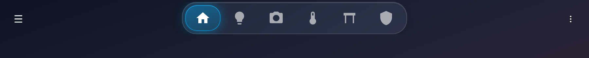
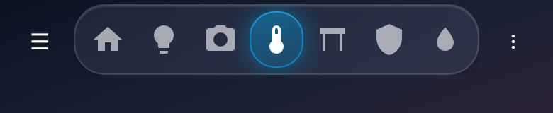
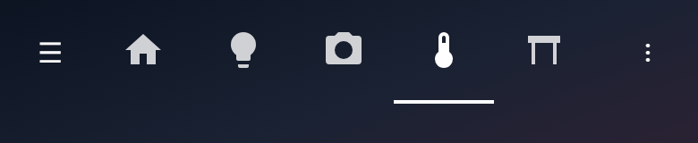

# Arcane Tab Dock

A new look for the Home Assistant dashboard tab bar. The tabs sit in one frosted capsule, the open tab glows, and the tabs shrink to share the space, so seven or eight views fit across a phone without sideways scrolling.

[![hacs][hacs-badge]][hacs-link]
[![Buy Me a Coffee][bmc-badge]][bmc-link]



<p>
  
  
</p>

- Nothing to add to your dashboards. Install it and every dashboard's tab bar changes.
- Follows your theme's text and primary colours, in light and dark themes.
- Goes back to the normal tab bar while you edit a dashboard.
- Can also hide the menu button and the three dots on phones and tablets (off by default).
- Works with icon tabs and with text tabs.

## Install

### HACS (recommended)

1. In HACS, open the three-dot menu, choose **Custom repositories**, add `https://github.com/deekay2153/arcane-tab-dock` with the type **Dashboard**.
2. Search for **Arcane Tab Dock** and download it.
3. Reload your browser.

HACS adds the file to your dashboard resources for you.

### By hand

1. Download `arcane-tab-dock.js` from the [latest release](https://github.com/deekay2153/arcane-tab-dock/releases/latest).
2. Put it in `config/www/`.
3. In **Settings → Dashboards → ⋮ → Resources**, add `/local/arcane-tab-dock.js` as a **JavaScript module**.
4. Reload your browser.

## Settings

There is nothing to set up, but you can change a few things with theme variables. Add them to the theme you use (in `themes.yaml` or your theme's file):

```yaml
my_theme:
  tab-dock-accent: "#f59e0b"       # colour of the open tab (default: your primary colour)
  tab-dock-tab-width: 60px         # width of one icon tab (default: 54px)
  tab-dock-hide-buttons: touch     # none, touch or always (default: none)
  tab-dock-disable: "true"         # turns the dock off for this theme
```

**`tab-dock-hide-buttons`** hides the menu button (☰) and the three dots (⋮), which leaves more room for tabs.

- `touch` hides them only on phones and tablets. Swipe in from the left edge to open the sidebar. To edit a dashboard, use a computer or add `?edit=1` to the dashboard's address.
- `always` hides them everywhere.

The back arrow on subviews always stays.

### Without editing a theme

If your theme comes from HACS (an update would undo your changes) or different devices use different themes, put the settings in a small style sheet instead. Create `config/www/tab-dock.css`:

```css
:root {
  --tab-dock-hide-buttons: touch;
}
```

and add `/local/tab-dock.css` in **Settings → Dashboards → ⋮ → Resources** as a **Stylesheet**. It works for every theme.

## Good to know

- Home Assistant has no setting for the tab bar, so the dock adds a small style sheet to the dashboard header. If a Home Assistant update renames the parts it styles, the tab bar simply goes back to the normal look until the dock is updated.
- Made for the tab bar Home Assistant has used since 2025.5, and in daily use on 2026.11.
- It only changes how the tab bar looks. Your dashboards and their settings stay the same. To remove it, delete it in HACS (or remove the resource) and reload.

## Try it without Home Assistant

`preview/index.html` runs the dock on a stand-in for the Home Assistant header. From the repo folder:

```
python -m http.server 8800
```

then open <http://127.0.0.1:8800/preview/index.html>. Options: `?n=8` tabs, `?a=2` open tab, `?accent=%23f59e0b`, `?hide=always`, `?stock` for the normal look.

## Support

If you like the dock, you can [buy me a coffee][bmc-link]. Thank you!

Found a bug or have an idea? [Open an issue](https://github.com/deekay2153/arcane-tab-dock/issues).

## Licence

MIT, see [LICENSE](LICENSE).

[hacs-badge]: https://img.shields.io/badge/HACS-Custom-41BDF5.svg
[hacs-link]: https://hacs.xyz
[bmc-badge]: https://img.shields.io/badge/Buy%20me%20a%20coffee-FFDD00?logo=buymeacoffee&logoColor=black
[bmc-link]: https://www.buymeacoffee.com/deekay2153
